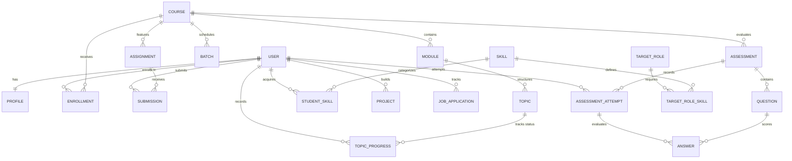

# SkillTrack — Smart Learning & Career Progress Platform

SkillTrack is a modern, full-stack learning and career intelligence SaaS platform built for engineers, faculty mentors, and academic administrators. It connects curriculum tracking, mentor-evaluated capstones, verified conceptual quizzes, and deterministic **Skill Gap Analytics** to help students reach career readiness for high-demand software engineering roles.

---

## 🎨 Visual Design System

The application strictly implements a **Light Pink + White** modern SaaS aesthetic:
- **Background**: Very pale blush pink (`#FFF5F7`)
- **Main Surfaces & Cards**: Pure crisp white (`#FFFFFF`) with rounded corners (`16px-18px`) and subtle drop shadows
- **Primary Accent**: Soft rose pink (`#E98EAD`) with deeper hover (`#D96C94`)
- **Light Accent Surfaces**: Soft blush (`#FCE7EF`)
- **Typography & Dark Contrast**: Charcoal text (`#29252B`) and muted gray (`#77717A`)
- **Borders**: Delicate pink-gray (`#F0DFE5`)
- **State Badges**: Emerald (`#10B981`) for passing/success, Amber (`#F59E0B`) for reviews/deadlines, Purple for administrative controls

---

## 🏗️ Architecture & Technology Stack

### Backend
- **Framework**: Django 5.x / 6.x + Django REST Framework (DRF)
- **Authentication**: JWT authentication with `djangorestframework-simplejwt` (token pair generation, secure refresh rotation, client interceptors)
- **Database**: PostgreSQL support via `psycopg2-binary` / `django.db.backends.postgresql` with automatic zero-configuration SQLite default for rapid local development
- **API Documentation**: OpenAPI 3.0 schema and interactive Swagger UI / Redoc via `drf-spectacular`
- **Security & CORS**: Role-based access control (RBAC), object-level permission guards, password hashing (PBKDF2), file upload validation, and `django-cors-headers`
- **Testing**: Django test runner with 14 automated integration and unit tests covering all core workflows

### Frontend
- **Framework**: React 18+ with TypeScript
- **Bundler & Tooling**: Vite with hot module replacement (HMR) and optimized rollup production build
- **Styling**: Tailwind CSS configured with custom brand tokens and responsive layouts
- **Charts & Telemetry**: Recharts for interactive weekly study activity and skill distribution
- **Icons**: Lucide React
- **API Client**: Axios with automatic JWT request injection, 401 token refresh queue, and route protection

---

## 🏛️ Database Architecture & Entity Relationship Diagram



---

## 🚀 Getting Started

### 1. Prerequisites
- **Python**: 3.11+ or 3.12+
- **Node.js**: 18+ or 20+ (Node v22 verified)
- **npm**: 9+ or 10+

### 2. Backend Setup & Run

1. Navigate to the backend directory:
   ```bash
   cd backend
   ```

2. (Optional) Create and activate a virtual environment:
   ```bash
   python -m venv venv
   # On Windows PowerShell:
   .\venv\Scripts\Activate.ps1
   # On Linux/macOS:
   source venv/bin/activate
   ```

3. Install dependencies:
   ```bash
   pip install -r requirements.txt
   ```

4. Configure environment variables (a pre-configured `.env` is provided; see `.env.example`):
   ```bash
   cp .env.example .env
   ```

5. Apply migrations:
   ```bash
   python manage.py migrate
   ```

6. Seed rich demo data (creates curriculum, quizzes, skills, and pre-configured test users):
   ```bash
   python manage.py seed_data
   ```

7. Start the backend development server:
   ```bash
   python manage.py runserver 127.0.0.1:8008
   ```
   > **Note**: Interactive Swagger API docs will be available at: `http://127.0.0.1:8008/api/docs/`

### 3. Frontend Setup & Run

1. Navigate to the frontend directory:
   ```bash
   cd frontend
   ```

2. Install npm dependencies:
   ```bash
   npm install
   ```

3. Start the Vite development server:
   ```bash
   npm run dev
   ```
   > The web app will launch at `http://127.0.0.1:5173/`

4. (Optional) Run the production build check:
   ```bash
   npm run build
   ```

---

## 🔑 Pre-Configured Test User Credentials

The database seeder automatically initializes realistic accounts across all three platform roles:

| Role | Username | Email | Password | Access Capabilities |
| :--- | :--- | :--- | :--- | :--- |
| **Student** | `alex_student` | `student@skilltrack.dev` | `StudentPass123!` | Dashboard, Enrolled Courses, Progress Tracking, Quizzes, Skill Gap Analyzer, Projects, Job Tracker |
| **Mentor** | `sarah_mentor` | `mentor@skilltrack.dev` | `MentorPass123!` | Faculty Hub, Course Content Studio, Module & Topic Editor, Assignment Grading & Feedback, Assessment Bank |
| **Administrator** | `admin` | `admin@skilltrack.dev` | `AdminPass123!` | Executive Command Center, User Directory, Role Assignment, Account Activation Toggling, Platform Reports |

> **Tip**: The login page and top navigation bar include instant **1-Click Quick Switch** buttons to test any role with zero typing!

---

## 🧪 Testing & Quality Assurance

### Run Backend Test Suite
Run the 14 automated unit and integration tests covering authentication, authorization rules, course enrollment uniqueness, dynamic progress calculation, assignment grading, and skill gap calculations:
```bash
cd backend
python manage.py test
```

### Run Frontend Production Build Validation
```bash
cd frontend
npm run build
```

---

## 📡 Core API Endpoint Reference

| Domain | Method | Endpoint | Description |
| :--- | :--- | :--- | :--- |
| **Auth** | `POST` | `/api/auth/register/` | Register student or mentor account |
| **Auth** | `POST` | `/api/auth/login/` | Obtain access & refresh token pair |
| **Auth** | `POST` | `/api/auth/token/refresh/` | Refresh JWT access token |
| **Auth** | `GET/PATCH` | `/api/auth/me/` | View and edit user profile |
| **Auth** | `GET/PATCH` | `/api/auth/admin/users/` | Admin user directory and role toggle |
| **Courses** | `GET` | `/api/courses/` | List published courses with filters |
| **Courses** | `POST` | `/api/courses/{id}/enroll/` | Enroll student (enforces uniqueness) |
| **Courses** | `POST` | `/api/courses/topics/{id}/progress/` | Update topic status (Not Started/In Progress/Completed) |
| **Assignments** | `GET` | `/api/assignments/` | List enrolled assignments |
| **Assignments** | `POST` | `/api/assignments/{id}/submit/` | Submit project link/text/attachment |
| **Assignments** | `POST` | `/api/assignments/submissions/{id}/grade/` | Mentor score & qualitative feedback |
| **Assessments** | `GET` | `/api/assessments/{id}/take/` | Safe student quiz questions (no answer leak) |
| **Assessments** | `POST` | `/api/assessments/{id}/submit/` | Server-evaluated quiz scoring & attempt recording |
| **Careers** | `GET` | `/api/careers/gap-analysis/{role_id}/` | Deterministic Skill Gap Analyzer calculation |
| **Careers** | `GET/POST`| `/api/careers/my-skills/` | Manage student skill inventory |
| **Careers** | `GET/POST`| `/api/careers/job-applications/` | Job application pipeline tracking |
| **Projects** | `GET/POST`| `/api/projects/` | Portfolio projects showcase CRUD |
| **Docs** | `GET` | `/api/docs/` | Interactive Swagger OpenAPI UI |
